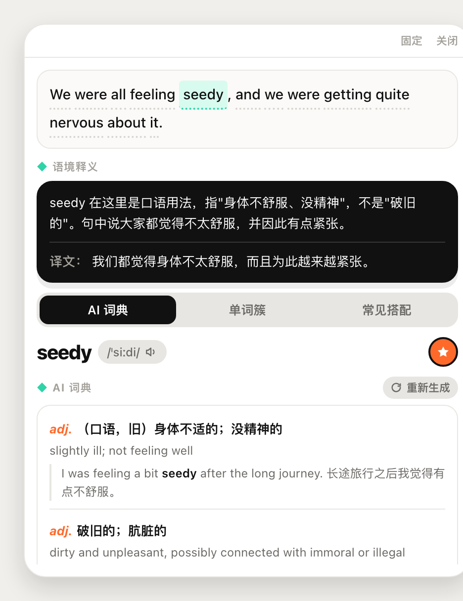
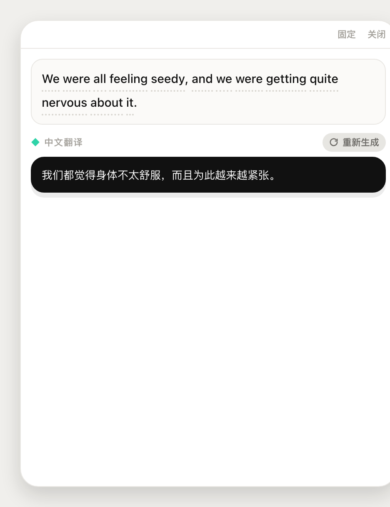
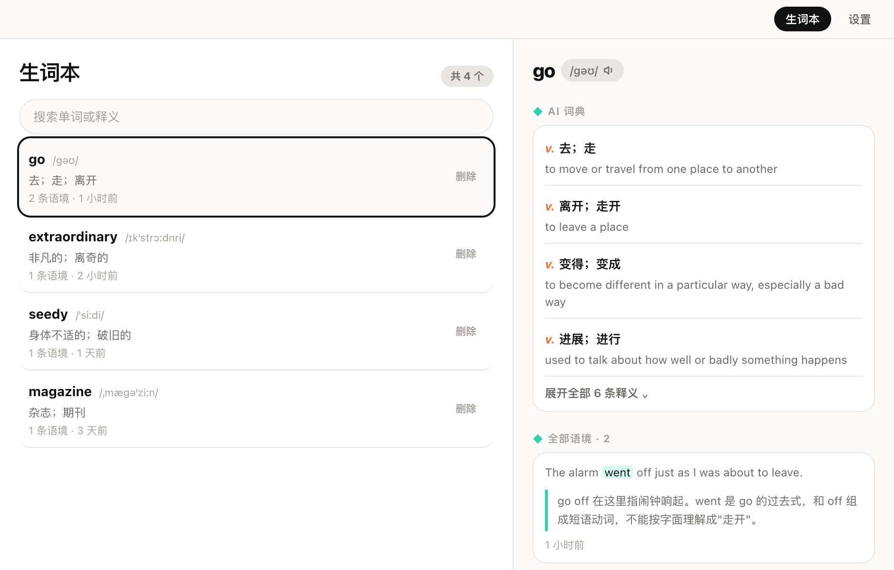
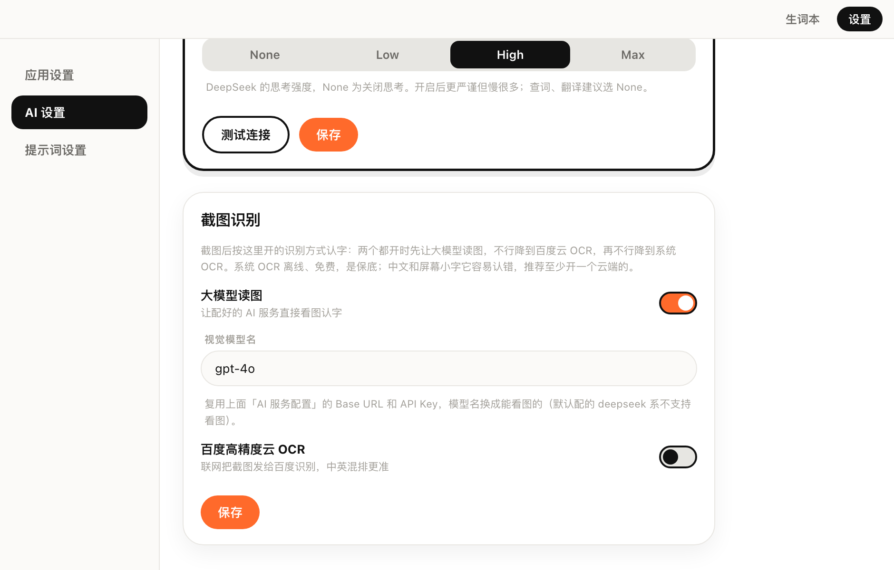
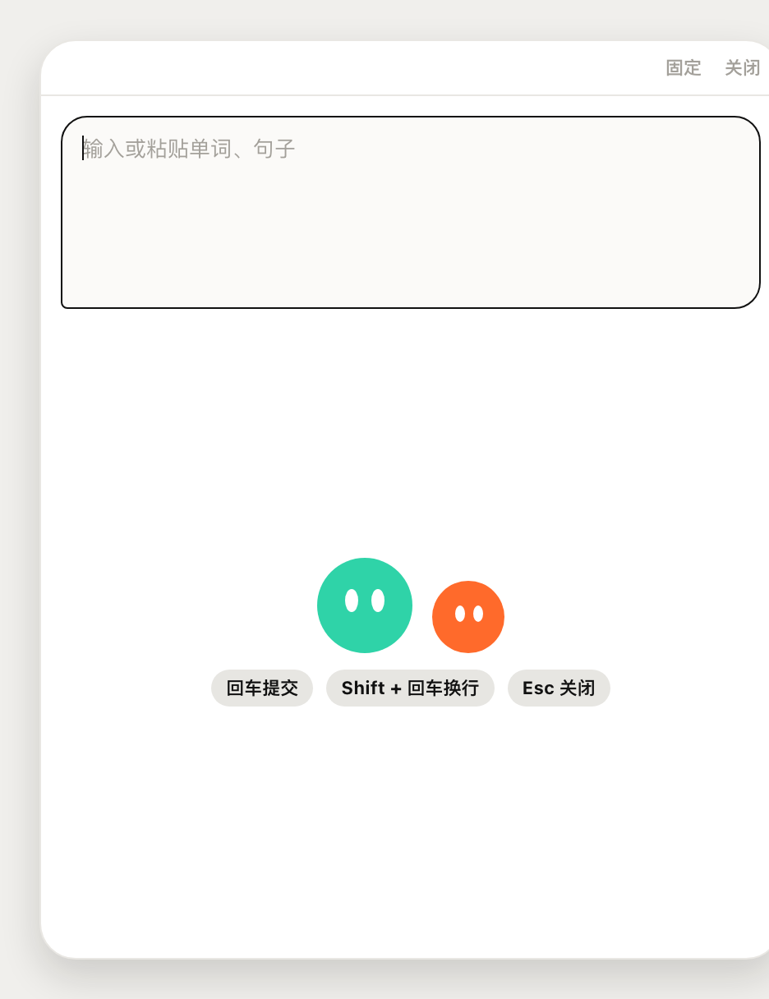

# AI-dict

个人自用的桌面划词翻译工具：在任意应用里选中文字按快捷键，鼠标旁弹出翻译。句子里的每个词都能点开，看的是**它在这句话里的意思**，而不是词典里的通用释义。

macOS 和 Windows 都能用，界面只有浅色一套。

<p align="center">
  
  
</p>

## 功能

### 划词翻译

- 任意应用里选中文字，按快捷键（macOS 默认 `Alt+D`，Windows 默认 `Ctrl+Alt+D`），弹窗出现在鼠标旁
- 自动分类：单词和词组出词卡，句子出原文 + 译文
- 流式输出，译文首字很快出现
- 弹窗可固定、可拖动，按 `Esc` 关闭

### 句子模式

- 原句里的每个词都可以点，标点除外
- 点词显示它在这句话里的语境释义，下面是 AI 词典、单词簇、常见搭配三个 Tab
- 再点一次高亮的词回到译文
- 中文输入走中译英，额外给一节句意解释，讲为什么这么选词

### 单词模式

- 输入翻译快捷键唤出输入框，也可以直接划一个词
- AI 词典、单词簇、常见搭配
- 音标、发音（英音 / 美音可切换）

### 截图翻译

- 第三个快捷键（macOS 默认 `Alt+X`，Windows 默认 `Ctrl+Alt+X`）框选屏幕区域
- 识别出来的文字和划词一样，走分类、可点词、可收藏
- 识别引擎可配置：勾选的可选引擎按 **大模型读图 → 百度高精度云 OCR → 系统 OCR** 的顺序尝试，前一层失败自动降到下一层
  - **大模型读图**：填视觉模型名，复用 AI 服务的 Base URL / API Key
  - **百度高精度云 OCR**：填 API Key / Secret Key
  - **系统 OCR**：兜底，离线免费。macOS 用 Vision，Windows 用 `Windows.Media.Ocr`
- 没认出文字、或没有屏幕录制权限时，会给出对应提示

### 生词本

- 词卡上点星标，收藏单词和它所在的语境
- 同一个词在新句子里再收藏，会追加一条语境
- 主窗口可按时间浏览、搜索、删除，详情里能看到 AI 词典和全部语境

### 设置

- AI 服务：任何兼容 OpenAI 接口的服务，填 Base URL、模型名、API Key
- 三个全局快捷键可改，保存后立即生效
- 发音口音、开机启动
- 提示词可自定义，输出格式固定
- 数据存在本机 SQLite，API Key 只在本机数据库里，不会发到别处

## 界面

| 生词本 | AI 与截图识别设置 |
| :---: | :---: |
|  |  |

| 单词模式 | 输入翻译 |
| :---: | :---: |
|  |  |

## 技术栈

- **桌面框架**：Tauri 2
- **前端**：React 19 + TypeScript + Vite + Tailwind CSS 4
- **系统能力**：Rust（取选中文字、截图框选、系统 OCR）
- **存储**：SQLite（`tauri-plugin-sql`）
- **网络**：`tauri-plugin-http`，绕过 CORS、支持流式
- **AI**：OpenAI 兼容的 Chat Completions 接口（如 `deepseek-chat`）

## 开发

需要 Node.js、pnpm、Rust stable，以及 [Tauri 2 的平台依赖](https://v2.tauri.app/start/prerequisites/)。

```bash
pnpm install
pnpm tauri dev      # 开发运行
pnpm typecheck
pnpm lint
pnpm test
pnpm tauri build    # 打包
```

### 权限

- **macOS 划词**：需要「辅助功能」权限，弹窗里会引导打开系统设置，授权后不用重启
- **macOS 截图**：需要「屏幕录制」权限，授权后要退出并重新打开应用
- **Windows**：截图框选是应用自己的透明窗口，不需要额外权限

> 开发期从终端启动时，macOS 的辅助功能权限算在终端（如 iTerm）头上。

## 说明

- 个人自用项目，未附带开源许可证。
- 界面和交互参考过 pot 和 ReadingBook，代码为自行实现；取选中文字使用 MIT 协议的 `get-selected-text`。
